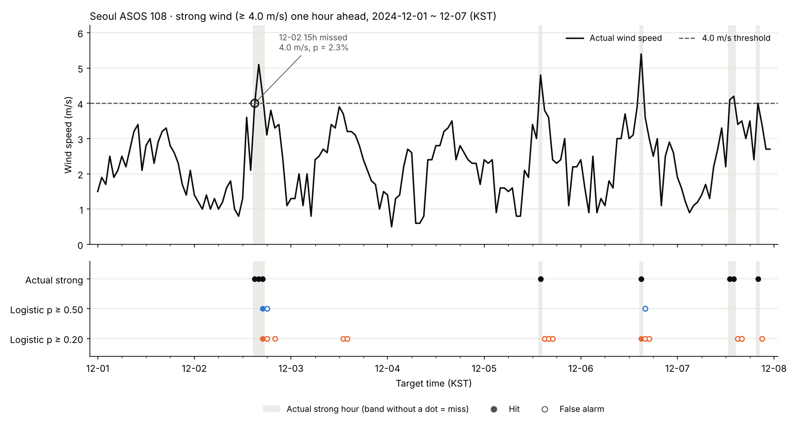

# Week 12 · 분류(Classification) — 1시간 뒤 강풍 여부 예측

## 문제 정의
| 항목 | 내용 |
|---|---|
| 자료 | 서울 ASOS 108, 2023-01 ~ 2024-12 (KST), 11주차 `wind_dataset.csv` |
| 입력 5개 | 현재 풍속·기온·습도, 1시간 전 풍속, 2시간 전 풍속 (예측 시각까지 알 수 있는 값) |
| 정답 | 1시간 뒤 실제 풍속 ≥ 4.0 m/s → 1(강풍), 아니면 0 (4.0 포함, 기상특보 기준과는 별개) |
| 판정 | 로지스틱 회귀의 강풍 확률 ≥ 0.50 → 1 (실습 4에서 0.20 추가) |
| 학습 | 정답 시각 2023-01-01 03시 ~ 2024-11-30 23시, 16,720행 |
| 평가 | 정답 시각 2024-12-01 00시 ~ 12-31 23시, 744행 (평가 중 모델·표준화 기준 고정) |

## 파일과 실행 순서
```bash
pip install pandas scikit-learn matplotlib

python classify_wind.py       # 실습 1~4
python plot_strong_wind.py    # 실습 5 (그래프 창을 닫으면 종료)
```
| 파일 | 내용 |
|---|---|
| `wind_dataset.csv` | 11주차 [`make_dataset.py`](../week11/make_dataset.py) 결과 복사본. `ws_next` 열이 강의 프롬프트의 `wind_next1h` |
| `classify_wind.py` | 정답 붙이기, 학습·평가 분할, 기준 예측 2개 + 표준화·로지스틱 회귀, 평가, 판정 기준 비교 |
| `classification_predictions.csv` | 12월 744행: 두 시각, 실제 풍속·정답, 현재 풍속, 두 기준 예측, 강풍 확률, 0.50·0.20 판정 |
| `classification_scores.csv` | 방법별 적중·놓침·오경보·정상 판정, 정확도·정밀도·재현율 (0.20은 마지막 행) |
| `plot_strong_wind.py` | 12월 1~7일 그래프, 12월 2일 틀린 사례 출력 |
| `strong_wind_december.png` | 위: 실제 풍속 + 4.0 m/s 기준선 / 아래: 실제 강풍과 0.50·0.20 예측 |

## 실습 1 확인: 정답과 기간
| 구분 | 전체 | 0 (강풍 아님) | 1 (강풍) | 강풍 비율 |
|---|---|---|---|---|
| 학습 | 16,720 | 15,427 | 1,293 | 7.7% |
| 12월 평가 | 744 | 705 | 39 | 5.2% |

- 17,464행 모두 `정답 시각 − 예측 시각 = 1시간`이고 중복 시각은 0개이며 시간순으로 정렬됨.
- 학습의 마지막 정답 시각(2024-11-30 23시)이 첫 평가의 예측 시각과 같음.

## 실습 2 확인: 첫 평가 행
| 항목 | 첫 평가 행 |
|---|---|
| 예측 시각 / 정답 시각 (KST) | 2024-11-30 23:00 / 2024-12-01 00:00 |
| 실제 풍속 / 정답 | 1.5 m/s / 0 |
| 현재 풍속 / 현재 상태 유지 | 2.1 m/s / 0 |
| 강풍 추정 확률 / 0.50 판정 | 1.4% / 0 |

표준화한 입력의 계수는 현재 풍속 +1.58, 1시간 전 +0.54, 2시간 전 +0.11, 기온 −0.09, 습도 +0.03이다.
강풍 확률은 주로 현재 풍속에 따라 달라진다.

## 실습 3·4 확인: 같은 12월 744행 비교
| 방법 | 정확도 | 정밀도 | 재현율 | 적중 | 오경보 | 놓침 | 정상 판정 |
|---|---|---|---|---|---|---|---|
| 항상 0 | 94.8% | 해당 없음 | 0.0% | 0 | 0 | 39 | 705 |
| 현재 상태 유지 | 91.9% | 23.1% | 23.1% | 9 | 30 | 30 | 675 |
| 로지스틱 0.50 | 94.5% | 40.0% | 10.3% | 4 | 6 | 35 | 699 |
| 로지스틱 0.20 | 91.3% | 26.8% | 38.5% | 15 | 41 | 24 | 664 |

모든 방법에서 적중 + 놓침 = 39(실제 강풍 수)이다.
0.20은 0.50보다 강풍을 11건 더 맞혔고, 오경보도 35건 늘었다.

## 실습 5: 12월 1~7일


회색 띠는 실제 강풍 시각이다. 띠 위에 예측 점이 없으면 놓침이고, 빈 점은 오경보이다.

12월 2일 틀린 사례:

| 정답 시각 | 예측 시각 풍속 | 실제 풍속 | 정답 | 강풍 확률 | 0.50 판정 | 0.20 판정 |
|---|---|---|---|---|---|---|
| 15:00 | 2.1 m/s | 4.0 m/s | 1 | 2.3% | 놓침 | 놓침 |
| 16:00 | 4.0 m/s | 5.1 m/s | 1 | 17.1% | 놓침 | 놓침 |
| 17:00 | 5.1 m/s | 4.2 m/s | 1 | 68.1% | 적중 | 적중 |
| 18:00 | 4.2 m/s | 3.1 m/s | 0 | 55.3% | 오경보 | 오경보 |
| 20:00 | 3.8 m/s | 3.3 m/s | 0 | 21.9% | 정상 판정 | 오경보 |

## 분석
1. **정확도만으로는 판단할 수 없다.** 항상 0이 정확도 94.8%로 가장 높지만 강풍 39건을 모두 놓쳤다(재현율 0%). 강풍이 5.2%뿐인 자료에서는 정확도가 0을 많이 맞힌 결과만 반영한다.
2. **판정 기준을 낮추면 놓침이 줄고 오경보가 늘어난다.** 0.50 → 0.20에서 재현율은 10.3% → 38.5%로 올랐고, 정밀도는 40.0% → 26.8%로 내려갔다. 강풍을 놓치는 피해가 오경보보다 크면 0.20 쪽이 낫다. 모델과 실제 강풍 기준은 바꾸지 않았다.
3. **갑자기 세지는 바람은 놓친다.** 실제 강풍 39건 중 30건은 예측 시각 풍속이 4.0 m/s 미만이었다. 1시간 안에 기준을 넘은 경우다. 0.50 판정은 이 30건을 하나도 맞히지 못했고, 0.20도 8건만 맞혔다. 12월 2일 15시가 대표 사례다. 14시 2.1 m/s에서 15시 4.0 m/s로 올랐지만, 입력 5개에는 이 증가를 알려 주는 값이 없어 확률이 2.3%에 그쳤다.
4. **오경보는 강풍 직후에 몰린다.** 0.20 판정의 오경보 41건 중 39건은 예측 시각 풍속이 3.5 m/s 이상이었다. 바람이 잦아드는 시각에 1시간 늦게 반응한 것이다. 12월 2일 18시가 그 예다(17시 4.2 → 18시 3.1 m/s, 확률 55.3%). 그래프에서 빈 점이 회색 띠 바로 오른쪽에 붙어 있는 것도 같은 현상이다.

## Copilot 요청과 직접 확인
| 단계 | 요청 요지 (강의 프롬프트) | 직접 확인한 결과 |
|---|---|---|
| 실습 1 | 4.0 m/s 이상 → 1, 정답 시각 기준 학습·평가 분할, 1시간 차이 확인 | 16,720행(1: 1,293) / 744행(1: 39), 1시간이 아닌 행 0개 |
| 실습 2 | 항상 0·현재 상태 유지 기준, 학습 행으로만 표준화·로지스틱 회귀, 가중치 없음 | 예측 CSV 744행, 첫 행 확률 1.4%, `ws_next`는 입력에서 제외 |
| 실습 3 | 세 방법의 적중·놓침·오경보·정상 판정, 정확도·정밀도·재현율 | 적중 + 놓침 = 39, 항상 0의 정밀도는 해당 없음 |
| 실습 4 | 같은 확률로 0.20 판정 추가, 예측 CSV 새 열, 평가 CSV 새 행 | 적중 4 → 15, 오경보 6 → 41 |
| 실습 5 | 12월 1~7일 두 그래프, 같은 정답 시각 축, 12월 2일 틀린 사례 | 15시 놓침(2.3%), 18시 오경보(55.3%) |
